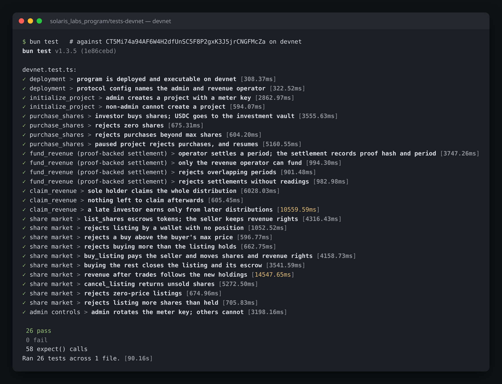
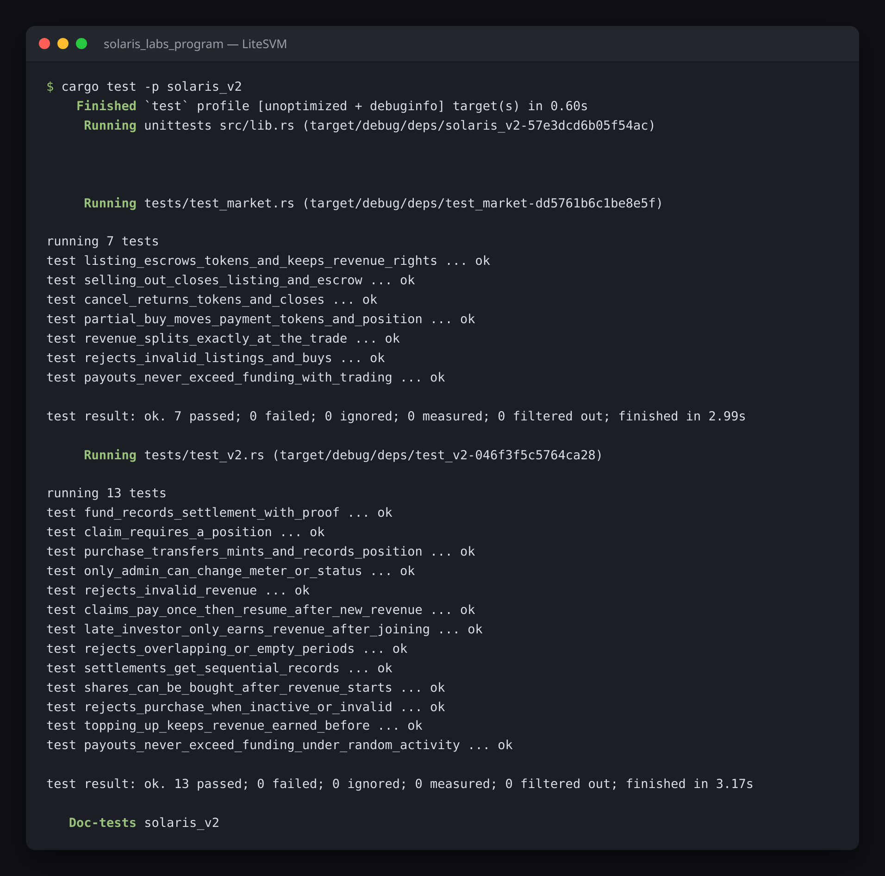
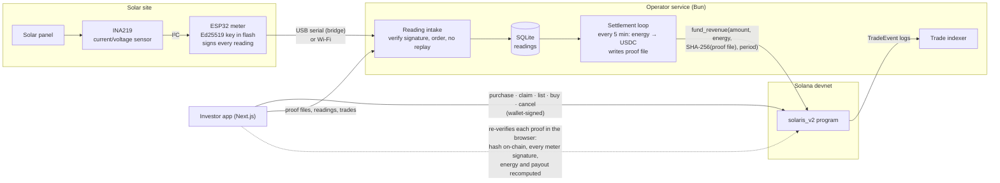
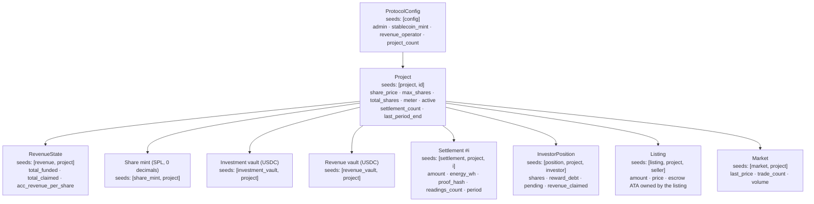
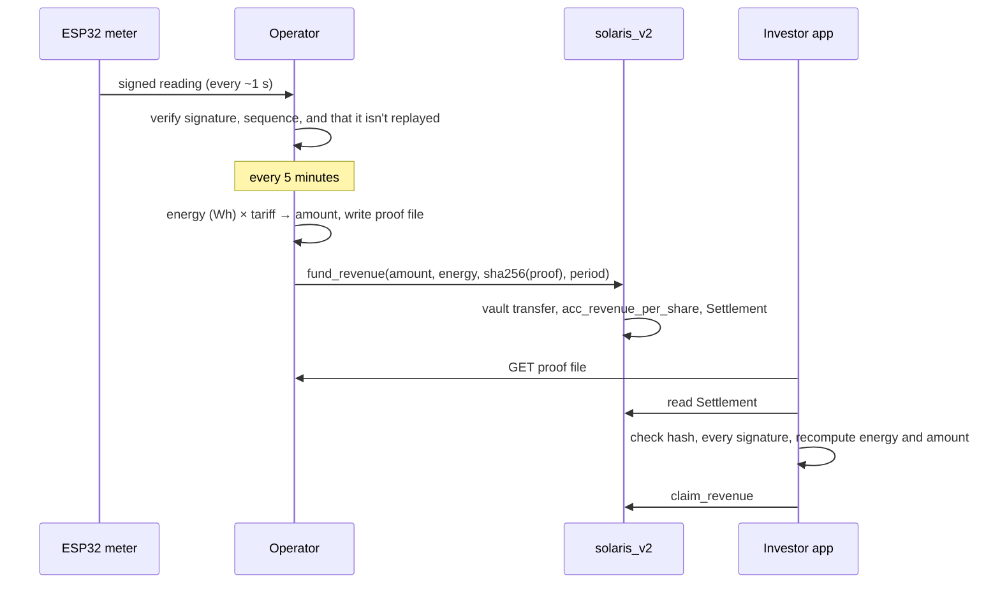

# Solaris Labs

Tokenized ownership of solar arrays on Solana. Investors buy shares of a solar project, earn a pro-rata share of the
revenue from the energy it sells, and can **verify every payout**: each distribution is backed by meter readings
signed by the hardware meter, and the hash of those readings is stored on-chain. Shares can be resold to other
investors on a built-in secondary market.

Pilot on **Solana devnet** with a real ESP32 + INA219 meter on a small panel. All assets are test tokens.

## Devnet deployment

| | |
|---|---|
| **Program ID** | [`CT5Mi74a94AF6W4H2dfUnSC5F8P2gxK3J5jrCNGFMcZa`](https://explorer.solana.com/address/CT5Mi74a94AF6W4H2dfUnSC5F8P2gxK3J5jrCNGFMcZa?cluster=devnet) (`solaris_v2`) |
| Test USDC mint | `GMuezHigniE8itiiMEZBhKi91p6eGxESTmmP5zMM7ZF3` |
| Project 0: Solaris Rooftop 01 (ESP32 meter) | `9EnmUpKTxqJuGudhamyQBW5ULpaugiyhMsAyqQqSAaVK` |
| Project 3: Eshan Rooftop (software meter) | `711v76fB9mCnDNaP4C6LYGHvfA4jaqManVhTUDBNkJVE` |
| Investor app | https://solaris-labs-rose.vercel.app |
| Earlier v1 POC program | `CgsfxU8Lv5iXXSHmt5NbNEurxXhVqwsQ9UJHjBCp9iQC` (`solaris_labs_program`, fixed-round model) |

## Tests

### Against the deployed program on devnet: 26 passing

[`solaris_labs_program/tests-devnet/devnet.test.ts`](solaris_labs_program/tests-devnet/devnet.test.ts) sends real
transactions to the deployed program. Each run creates a fresh project, so live projects are never touched, and
covers every instruction plus the error paths that guard them.



```bash
cd solaris_labs_program/tests-devnet
bun install
RPC_URL=<devnet RPC URL> bun test --timeout 120000
# needs ADMIN_KEYPAIR (protocol admin + test-USDC mint authority, default ~/.config/solana/id.json)
# and OPERATOR_KEYPAIR (revenue operator, default operator/.keys/operator.json)
```

### Program unit and property tests (LiteSVM): 20 passing

[`programs/solaris_v2/tests/`](solaris_labs_program/programs/solaris_v2/tests) runs the compiled program in
LiteSVM. Besides unit cases, two randomized tests run hundreds of mixed purchases, settlements, trades and claims and
check after every step that payouts never exceed funding and that trades conserve shares.



```bash
cd solaris_labs_program
anchor build -p solaris_v2
cargo test -p solaris_v2
```

There are also off-chain tests: `cd operator && bun test` checks the proof rules and that the operator and browser
copies of the verifier are identical.

## Architecture

### System overview



- The **meter** is the root of trust for production data. Its public key is stored on-chain in the `Project`
  account. Readings are signed as `solaris-reading-v1:<boot>:<seq>:<mV>:<µA>`, so the operator can't invent or alter
  them without the signatures failing.
- The **operator** is the only key allowed to fund revenue (`ProtocolConfig.revenue_operator`). Each settlement
  publishes the exact proof file whose SHA-256 is written on-chain.
- The **app** never trusts the operator's numbers. It downloads the proof file and checks it against the chain in
  the browser (9 checks). Changing one reading by 1 µA makes verification fail.

### On-chain accounts



All vaults and mints are program-owned PDAs. The program signs every transfer out of them; no private key controls them.

### Instructions

| Instruction | Signer | Effect |
|---|---|---|
| `initialize_config` | admin | Sets the stablecoin mint and revenue operator |
| `set_revenue_operator` | admin | Rotates the operator key |
| `initialize_project` | admin | Creates the project, revenue state, share mint and both vaults; records the meter key |
| `set_meter` | admin | Rotates the meter key (e.g. hardware replacement) |
| `set_project_active` | admin | Pauses or resumes primary sales |
| `purchase_shares` | investor | USDC → investment vault, mints share tokens, checkpoints the position |
| `fund_revenue` | operator | USDC → revenue vault, raises `acc_revenue_per_share`, creates a `Settlement` with the proof hash; periods may not overlap |
| `claim_revenue` | investor | Pays everything the position has earned so far |
| `list_shares` | holder | Moves N share tokens into an escrow owned by the `Listing` PDA, at a fixed price |
| `buy_listing` | buyer | Buyer pays the seller in USDC, escrow releases the shares, and the revenue rights move with them; `max_price` guards against price changes |
| `cancel_listing` | seller | Returns unsold shares and closes the listing and escrow |

### Revenue accounting

Investors can join at any time, so revenue is tracked per share, as in a staking reward pool:

```
fund_revenue:   acc_revenue_per_share += amount × 10¹² / total_shares
claimable     = pending + (shares × acc_revenue_per_share − reward_debt) / 10¹²
checkpoint    : pending = claimable;  reward_debt = shares × acc_revenue_per_share
```

The program checkpoints a position before its share count changes (purchase, or either side of a trade). So:

- a new investor earns only from later distributions;
- a seller keeps everything earned up to the sale;
- the buyer earns from the next distribution on.

Rounding is always down, so the total claimed can never exceed the total funded. Both test suites check this.

### Settlement and trade flows



```mermaid
sequenceDiagram
  participant S as Seller
  participant P as solaris_v2
  participant B as Buyer
  S->>P: list_shares(n, price)  [tokens → listing escrow]
  B->>P: buy_listing(k, max_price)
  P->>P: checkpoint both positions, move k shares of revenue rights
  P-->>S: k × price USDC (from buyer)
  P-->>B: k share tokens (from escrow)
  P->>P: Market stats, emit TradeEvent; close listing when sold out
  S->>P: cancel_listing  [unsold tokens back]
```

### Trust model and known limits

- **Meter key:** whoever holds it can sign readings, so it is generated on the device and never leaves its flash.
  Rotating it (`set_meter`) is admin-only.
- **Operator:** the operator chooses when to settle and converts energy to money using published rules
  (`operator/src/proof.ts`). Anyone can recompute the result from the proof file. The operator can't pay out more than it deposits.
- **Timestamps:** the meter signs values and their order. The time of each reading is added by the operator when it
  arrives.
- **Proof checks use the current meter key:** after a `set_meter` rotation, older proofs need the key that was active
  when they were made. Storing a meter history is a planned improvement.

## Repository

| Folder | Contents |
|---|---|
| [`solaris_labs_program/`](solaris_labs_program) | Anchor workspace. `programs/solaris_v2` is the deployed program; `tests-devnet/` holds the devnet integration tests; `programs/solaris_labs_program` is the v1 POC. |
| [`operator/`](operator) | Bun service: signed-reading intake, settlement loop, proof files, trade indexer, faucet, HTTP API. |
| [`app/`](app) | Next.js investor app: offerings, subscribe, portfolio, collect, proof verification, share market. |
| [`firmware/`](firmware) | ESP32 meter firmware (`solar_meter/`), USB bridge, wiring diagrams. |
| [`docs/`](docs) | Test screenshots. |

## Run locally

```bash
cd solaris_labs_program && anchor build -p solaris_v2
cd operator && bun install && cp .env.example .env    # set RPC_URL; operator key and deployment from `bun run setup`
cd app && bun install                                  # app/.env.local: RPC_URL, OPERATOR_URL=http://localhost:4100
./run.sh            # operator, USB bridge (if an ESP32 is plugged in), virtual meter, app on :3100
./run.sh stop
```

Settings: `SETTLEMENT_PERIOD_SEC` (default 300) and `TEST_GAIN` (default 100; multiplies the measured current while the
small test panel drives a large load resistor) in `operator/.env`.

## Hardware

ESP32 DevKit, INA219 breakout, 6 V / 250 mA panel, load resistor. Wiring: [`firmware/diagrams/full_wiring.png`](firmware/diagrams/full_wiring.png).
Firmware details: [`firmware/README.md`](firmware/README.md).
